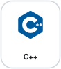
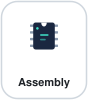
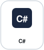
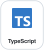
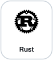

<p align="center">
  
</p>

<p align="center">
  <a href="INSTALL.md"></a>
  
  
  
</p>

# ProofRunKit

A single high-performance test executable, compiled once. Tests change; the binary does not.

<p align="center"><strong>Supported languages</strong></p>
<p align="center">
  Write tests in Lua or JavaScript. Compile and run C, C++, and Assembly with real toolchains.
</p>
<p align="center">
  
  
  
  
  
</p>
<p align="center"><sub>Planned</sub></p>
<p align="center">
  
  
  
  
  
  
  
  
</p>

**[⬇ Install ProofRunKit](INSTALL.md)**: Windows x64 MSI (v0.1.0). Other platforms are coming soon.

**Status: pre-alpha.** The core executable, Assembly hot paths, Windows x64 and x86 builds with a self-test, both Windows MSI installers, the `prk` command, and sandboxed Lua 5.4 and JavaScript (QuickJS-ng) test scripts are in the tree. Language drivers are next. Features below are marked Done, In progress, or Planned; see the [open issues](https://github.com/Patrick-W-McMahon/ProofRunKit/issues).

## Install

Download the Windows x64 installer from the [latest release](https://github.com/Patrick-W-McMahon/ProofRunKit/releases/latest),
then keep it current with `prk -update`. [INSTALL.md](INSTALL.md) has every platform and architecture (Windows x64
now; Windows x86, macOS, and Linux coming soon), checksum verification, the install location, uninstalling, and
building from source.

## Why ProofRunKit

Rebuilding a custom C or C++ test executable whenever tests change produces a new file on disk. Antivirus tools often treat that rebuild as an unknown binary and flag it again.

ProofRunKit is designed to be compiled once and then reused. Tests live outside the executable — as scripts, or as inputs to real compilers and runtimes — and are never compiled into the kit. When the tests change, only the tests change.

## Features

Each item is linked to its tracking issue. Status markers mean:

| Status | Meaning |
| --- | --- |
| Done | Present in the repository today |
| In progress | Implementation has started |
| Planned | Designed and ticketed; not started |

Checked boxes are Done. Unchecked boxes are In progress or Planned, as marked.

### Core executable

- [x] Single compiled `proofrunkit` executable and CMake presets ([#7](https://github.com/Patrick-W-McMahon/ProofRunKit/issues/7)) — Done
- [x] Short `prk` command with `run`, `list`, `version`, and `help` subcommands, installed on PATH as the same binary ([#60](https://github.com/Patrick-W-McMahon/ProofRunKit/issues/60)) — Done
- [x] Assembly hot paths with a mandatory portable C fallback, for x64 and x86 ([#8](https://github.com/Patrick-W-McMahon/ProofRunKit/issues/8), [#39](https://github.com/Patrick-W-McMahon/ProofRunKit/issues/39)) — Done
- [x] Process-spawn and sandbox layer on Windows ([#13](https://github.com/Patrick-W-McMahon/ProofRunKit/issues/13)) — Done ([docs/process-spawn.md](docs/process-spawn.md))
- [x] `prk test`: a checked-in `prk.tests.json` runs a whole project's tests with one combined summary and report ([#82](https://github.com/Patrick-W-McMahon/ProofRunKit/issues/82)) — Done ([docs/test-config.md](docs/test-config.md))
- [x] Windows build and `proofrunkit_selftest` via CTest ([#23](https://github.com/Patrick-W-McMahon/ProofRunKit/issues/23)) — Done
- [x] ProofRunKit tests itself with `prk test`; the C++ self-test keeps only internal cases and runs inside it ([#55](https://github.com/Patrick-W-McMahon/ProofRunKit/issues/55), [#96](https://github.com/Patrick-W-McMahon/ProofRunKit/issues/96)) — Done ([docs/self-hosting.md](docs/self-hosting.md))

### Test authoring (Lua 5.4 and QuickJS-ng)

- [x] Embedded, sandboxed Lua 5.4 for kit-authored tests loaded at runtime ([#9](https://github.com/Patrick-W-McMahon/ProofRunKit/issues/9), [guide](docs/lua-tests.md)) — Done
- [x] Embedded QuickJS-ng for kit-authored JavaScript tests ([#11](https://github.com/Patrick-W-McMahon/ProofRunKit/issues/11)) — Done ([docs/js-tests.md](docs/js-tests.md))
- [x] Test-authoring API in Lua and JavaScript (assertions, process spawn, file checks, timing, fixtures) ([#12](https://github.com/Patrick-W-McMahon/ProofRunKit/issues/12)) — Done (assertions, suites, hooks, tags, timeouts, timing, file checks, and `prk.run_process` / `prk.runProcess`)

### Compiled-language drivers

- [ ] C and C++ via gcc, clang, and MSVC `cl` ([#14](https://github.com/Patrick-W-McMahon/ProofRunKit/issues/14)) — Done (`prk.compile`: gcc, clang, and `cl` from PATH or vswhere/vcvarsall; executables, objects, static and shared libraries; parsed diagnostics; [docs/c-cpp-driver.md](docs/c-cpp-driver.md))
- [ ] C# via `dotnet` ([#15](https://github.com/Patrick-W-McMahon/ProofRunKit/issues/15)) — Planned
- [ ] Java via `javac` and `java` (JDK discovery) ([#44](https://github.com/Patrick-W-McMahon/ProofRunKit/issues/44)) — Planned
- [ ] Rust via `rustc` and `cargo` ([#45](https://github.com/Patrick-W-McMahon/ProofRunKit/issues/45)) — Planned
- [ ] Go via `go build` and `go test` ([#46](https://github.com/Patrick-W-McMahon/ProofRunKit/issues/46)) — Planned
- [ ] Assembly: assemble, link, execute, and check exit code and output, with `ml64` / `ml` on Windows and GAS or NASM elsewhere ([#16](https://github.com/Patrick-W-McMahon/ProofRunKit/issues/16)) — Done (`prk.assemble`: MASM from PATH or vswhere/vcvarsall, GAS, NASM; parsed diagnostics; link with `prk.compile`; [docs/asm-driver.md](docs/asm-driver.md))

### Script runtimes

- [ ] Python execution and pytest wrapping ([#17](https://github.com/Patrick-W-McMahon/ProofRunKit/issues/17)) — Planned
- [ ] Node.js execution and `node:test` / Vitest wrapping ([#18](https://github.com/Patrick-W-McMahon/ProofRunKit/issues/18)) — Planned
- [ ] TypeScript: `tsc --noEmit` type-checking, Node.js type stripping or compiled JavaScript, and Vitest ([#47](https://github.com/Patrick-W-McMahon/ProofRunKit/issues/47)) — Planned

### Web

- [ ] HTML and CSS validation and structure checks ([#19](https://github.com/Patrick-W-McMahon/ProofRunKit/issues/19)) — Planned
- [ ] Browser-driven HTML and CSS checks via Chrome ([#20](https://github.com/Patrick-W-McMahon/ProofRunKit/issues/20)) — Planned

### Wrapping existing suites

- [ ] pytest suites ([#17](https://github.com/Patrick-W-McMahon/ProofRunKit/issues/17)) — Planned
- [ ] `node:test` and Vitest suites ([#18](https://github.com/Patrick-W-McMahon/ProofRunKit/issues/18)) — Planned
- [ ] doctest suites ([#28](https://github.com/Patrick-W-McMahon/ProofRunKit/issues/28)) — Planned
- [ ] In-house header-only C++ harnesses ([#33](https://github.com/Patrick-W-McMahon/ProofRunKit/issues/33)) — Planned

### Reporting

- [x] Console, JSON, and JUnit XML reports, with a documented exit-code contract ([#21](https://github.com/Patrick-W-McMahon/ProofRunKit/issues/21)) — Done (see [docs/report-formats.md](docs/report-formats.md) and [docs/exit-codes.md](docs/exit-codes.md))

### Stability and security

- [ ] Stable binary across test changes, with a fixed artifact directory for compiler and test outputs ([#22](https://github.com/Patrick-W-McMahon/ProofRunKit/issues/22)) — In progress (reproducible builds, VERSIONINFO, and manifest done; see [stable-binary.md](docs/stable-binary.md))
- [x] Sandboxed process spawn for compilers, scripts, and produced binaries ([#13](https://github.com/Patrick-W-McMahon/ProofRunKit/issues/13)) — Done (timeouts kill the whole process tree; [docs/process-spawn.md](docs/process-spawn.md))
- [ ] Code signing decision for installers and SmartScreen / antivirus reputation ([#41](https://github.com/Patrick-W-McMahon/ProofRunKit/issues/41)) — In progress (installers ship unsigned for now)

### Distribution

- [x] Per-machine WiX v4 MSI installers: x64 to `%ProgramFiles%\ProofRunKit` and x86 to `%ProgramFiles(x86)%\ProofRunKit`, with optional PATH and Add/Remove Programs entries ([#36](https://github.com/Patrick-W-McMahon/ProofRunKit/issues/36), [#37](https://github.com/Patrick-W-McMahon/ProofRunKit/issues/37), [#38](https://github.com/Patrick-W-McMahon/ProofRunKit/issues/38), [#40](https://github.com/Patrick-W-McMahon/ProofRunKit/issues/40)) — Done

- [x] `prk -update` downloads, verifies (SHA-256), and installs the latest x64 release; `prk -version` reports whether one is newer ([#75](https://github.com/Patrick-W-McMahon/ProofRunKit/issues/75), [docs/update.md](docs/update.md)) — Done

### Platforms

- [x] Windows (x64 and x86) as the first tested host ([#23](https://github.com/Patrick-W-McMahon/ProofRunKit/issues/23)) — Done
- [ ] Linux testing ([#34](https://github.com/Patrick-W-McMahon/ProofRunKit/issues/34)) — Planned
- [ ] macOS testing ([#35](https://github.com/Patrick-W-McMahon/ProofRunKit/issues/35)) — Planned

### Documentation

- [x] Professional README and visual showcase ([#1](https://github.com/Patrick-W-McMahon/ProofRunKit/issues/1), [#2](https://github.com/Patrick-W-McMahon/ProofRunKit/issues/2), [#42](https://github.com/Patrick-W-McMahon/ProofRunKit/issues/42), [#43](https://github.com/Patrick-W-McMahon/ProofRunKit/issues/43)) — Done
- [x] [`LICENSE`](LICENSE) and [`NOTICE`](NOTICE) (Apache License 2.0) ([#3](https://github.com/Patrick-W-McMahon/ProofRunKit/issues/3)) — Done
- [x] [`DISCLAIMER.md`](DISCLAIMER.md) ([#4](https://github.com/Patrick-W-McMahon/ProofRunKit/issues/4)) — Done
- [x] [`CONTRIBUTING.md`](CONTRIBUTING.md), including the commit-to-issue convention ([#5](https://github.com/Patrick-W-McMahon/ProofRunKit/issues/5), [#25](https://github.com/Patrick-W-McMahon/ProofRunKit/issues/25)) — Done
- [x] [`CODE_STANDARDS.md`](CODE_STANDARDS.md) ([#6](https://github.com/Patrick-W-McMahon/ProofRunKit/issues/6)) — Done
- [x] [`docs/PROJECT_BRIEF.md`](docs/PROJECT_BRIEF.md) and [`docs/ARCHITECTURE.md`](docs/ARCHITECTURE.md) ([#24](https://github.com/Patrick-W-McMahon/ProofRunKit/issues/24)) — Done

## How it works

Kit-authored tests are ordinary Lua or JavaScript files on disk. The compiled `proofrunkit` executable loads them through embedded Lua 5.4 and QuickJS-ng interpreters and reports the results. The executable does not need to be rebuilt when those tests change.

<p align="center">
  
</p>

The planned binary contains a C/C++ core (CLI, test registry and runner, process spawn, fixtures, timing), the two embedded interpreters, Assembly hot paths with a mandatory portable C fallback selected by CMake, and reporters. User tests are not compiled into that binary.

<p align="center">
  
</p>

ProofRunKit is not an in-process compiler. For compiled languages it shells out to a real toolchain, captures diagnostics, exit codes, and output files, then launches the produced binary (or test runner) to check behavior. Script and TypeScript suites that already use Node.js, `tsc`, or Python are invoked the same way.

<p align="center">
  
</p>

## Supported languages

| Language | How it's tested | Toolchain | Status |
| --- | --- | --- | --- |
| C and C++ | Compile, then run the produced binary and check exit code, output, and timing | gcc, clang, MSVC `cl` | Done ([#14](https://github.com/Patrick-W-McMahon/ProofRunKit/issues/14), [docs/c-cpp-driver.md](docs/c-cpp-driver.md)) |
| C# | Build, then run the produced program | `dotnet` | Planned ([#15](https://github.com/Patrick-W-McMahon/ProofRunKit/issues/15)) |
| Java | Compile with `javac`, then run with `java` or `java -jar` | JDK (`JAVA_HOME` / `PATH`) | Planned ([#44](https://github.com/Patrick-W-McMahon/ProofRunKit/issues/44)) |
| Rust | `cargo build` / `cargo test` or `rustc`, then run artifacts | `rustc`, `cargo`, rustup (MSVC target on Windows) | Planned ([#45](https://github.com/Patrick-W-McMahon/ProofRunKit/issues/45)) |
| Go | `go build` / `go test -json`, then run artifacts | Go (`GOROOT` / `PATH`) | Planned ([#46](https://github.com/Patrick-W-McMahon/ProofRunKit/issues/46)) |
| Assembly | Assemble, link, execute, and check exit code and output | `ml64` / `ml` (Windows), GAS, NASM | Done ([#16](https://github.com/Patrick-W-McMahon/ProofRunKit/issues/16), [docs/asm-driver.md](docs/asm-driver.md)) |
| JavaScript | Kit-authored tests in QuickJS-ng; existing suites via Node.js | QuickJS-ng, Node.js, `node:test`, Vitest | Kit-authored tests done ([#11](https://github.com/Patrick-W-McMahon/ProofRunKit/issues/11)); Node.js planned ([#18](https://github.com/Patrick-W-McMahon/ProofRunKit/issues/18)) |
| TypeScript | Type-check with `tsc --noEmit`; run via Node.js type stripping or compiled JS; wrap Vitest | `tsc`, Node.js, Vitest | Planned ([#47](https://github.com/Patrick-W-McMahon/ProofRunKit/issues/47)) |
| Lua | Kit-authored tests loaded by the embedded, sandboxed interpreter | Lua 5.4.9 | Done ([#9](https://github.com/Patrick-W-McMahon/ProofRunKit/issues/9)) |
| Python | Run files and wrap pytest | System Python, pytest | Planned ([#17](https://github.com/Patrick-W-McMahon/ProofRunKit/issues/17)) |
| HTML and CSS | Validation and structure checks; browser-driven checks later | Static checkers; Chrome | Planned ([#19](https://github.com/Patrick-W-McMahon/ProofRunKit/issues/19), [#20](https://github.com/Patrick-W-McMahon/ProofRunKit/issues/20)) |

Lua test scripts run today; the compiler drivers and other runtimes are not implemented yet.

## Platform support

| Platform | Status |
| --- | --- |
| Windows x64 and x86 | First tested host — Done ([#23](https://github.com/Patrick-W-McMahon/ProofRunKit/issues/23), [#39](https://github.com/Patrick-W-McMahon/ProofRunKit/issues/39)) |
| Linux | Planned ([#34](https://github.com/Patrick-W-McMahon/ProofRunKit/issues/34)) |
| macOS | Planned ([#35](https://github.com/Patrick-W-McMahon/ProofRunKit/issues/35)) |

CMake presets for Linux and macOS may appear before those hosts are formally tested. A preset is not the same as a supported, tested platform.

## Getting started

ProofRunKit is pre-alpha. Windows x64 and x86 builds, a self-test, MSI installers, and Lua test scripts are available.

Build and test from a Developer PowerShell for Visual Studio 2026:

```powershell
cmake --preset windows-msvc-x64-debug
cmake --build --preset windows-msvc-x64-debug
ctest --preset windows-msvc-x64-debug --output-on-failure
```

Every build and both installers provide the short `prk` command alongside `proofrunkit`:

```powershell
prk run tests\math_test.lua   # run a Lua test script (see docs/lua-tests.md)
prk run --json          # run tests and report JSON
prk run --junit-file out\results.xml tests\math_test.lua   # also write JUnit XML (docs/report-formats.md)
prk list --filter kit.  # list test names
prk help run            # help for one command
prk test --build-dir build\windows-msvc-x64-debug   # run the project's prk.tests.json (docs/test-config.md)
prk -version            # version, engines, and whether a newer release exists (-offline skips the check)
prk -update -check      # is there a newer release?
prk -update             # download, verify (SHA-256), and install the latest x64 MSI (docs/update.md)
```

See [docs/building-windows.md](docs/building-windows.md) for prerequisites, the 32-bit presets, and options, and [docs/installer-windows-x64.md](docs/installer-windows-x64.md) and [docs/installer-windows-x86.md](docs/installer-windows-x86.md) for building the MSI installers. The design is described in [docs/PROJECT_BRIEF.md](docs/PROJECT_BRIEF.md) and [docs/ARCHITECTURE.md](docs/ARCHITECTURE.md).

## Roadmap

The project is not complete until ProofRunKit has replaced at least one real existing test suite end to end ([#26](https://github.com/Patrick-W-McMahon/ProofRunKit/issues/26)). Suites will be migrated one project at a time. Existing test tools remain in place as a fallback until the maintainer approves removal ([#27](https://github.com/Patrick-W-McMahon/ProofRunKit/issues/27)).

The first planned suite migration is an existing doctest C++ suite ([#28](https://github.com/Patrick-W-McMahon/ProofRunKit/issues/28)). The full list, including installers and remaining documentation, is in the [issue tracker](https://github.com/Patrick-W-McMahon/ProofRunKit/issues).

## Contributing

Contributions are welcome. Read [`CONTRIBUTING.md`](CONTRIBUTING.md) and [`CODE_STANDARDS.md`](CODE_STANDARDS.md) first. In short: open an issue before starting work, reference it from every commit (`Refs #N` or `Closes #N`), and build and run the self-test locally. There is currently no GitHub Actions CI. Windows is the first test host.

## License

ProofRunKit is licensed under the **Apache License 2.0**. See [`LICENSE`](LICENSE) and [`NOTICE`](NOTICE).

## Disclaimer

See [`DISCLAIMER.md`](DISCLAIMER.md). ProofRunKit runs compilers, scripts, and binaries that you supply; use it at your own risk. The disclaimer does not modify the Apache License 2.0 terms.

## Attribution

If you use ProofRunKit, please credit the project and link to this repository: [https://github.com/Patrick-W-McMahon/ProofRunKit](https://github.com/Patrick-W-McMahon/ProofRunKit).

Downstream redistributions should retain attribution notices. See [`NOTICE`](NOTICE) per Apache License 2.0, section 4(d).
