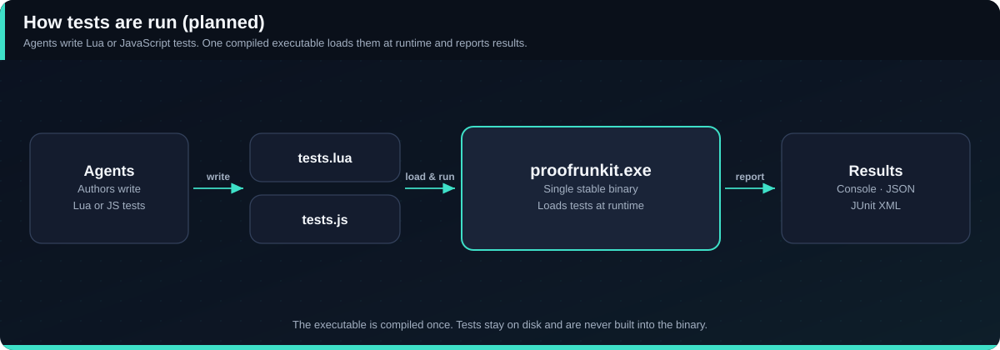
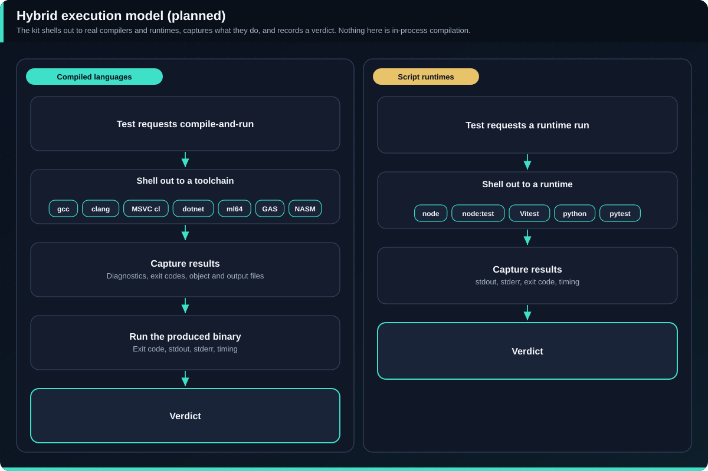

  

  
  
  

# ProofRunKit

A single high-performance test executable, compiled once. Tests change; the binary does not.

**Status: planning / pre-alpha.** Features below describe the intended product. Only the public documentation and visual showcase are in the tree today. See the [open issues](https://github.com/Patrick-W-McMahon/ProofRunKit/issues).

## Why ProofRunKit

Rebuilding a custom C or C++ test executable whenever tests change produces a new file on disk. Antivirus tools often treat that rebuild as an unknown binary and flag it again.

ProofRunKit is designed to be compiled once and then reused. Tests live outside the executable — as scripts, or as inputs to real compilers and runtimes — and are never compiled into the kit. When the tests change, only the tests change.

## Features

Each item is linked to its tracking issue. Status markers mean:

| Status | Meaning |
| --- | --- |
| Done | Present in the repository today |
| In progress | Implementation has started |
| Planned | Designed and ticketed; not started |

Unchecked boxes are Planned. Checked boxes are Done.

### Core executable

- [ ] Single compiled `proofrunkit` executable and CMake presets ([#7](https://github.com/Patrick-W-McMahon/ProofRunKit/issues/7)) — Planned
- [ ] Assembly hot paths with a mandatory portable C fallback ([#8](https://github.com/Patrick-W-McMahon/ProofRunKit/issues/8)) — Planned
- [ ] Process-spawn and sandbox layer on Windows ([#13](https://github.com/Patrick-W-McMahon/ProofRunKit/issues/13)) — Planned
- [ ] Windows build and `proofrunkit_selftest` via CTest ([#23](https://github.com/Patrick-W-McMahon/ProofRunKit/issues/23)) — Planned

### Test authoring (Lua 5.4 and QuickJS-ng)

- [ ] Embedded Lua 5.4 for kit-authored tests loaded at runtime ([#9](https://github.com/Patrick-W-McMahon/ProofRunKit/issues/9)) — Planned
- [ ] Embedded QuickJS-ng for kit-authored JavaScript tests ([#11](https://github.com/Patrick-W-McMahon/ProofRunKit/issues/11)) — Planned
- [ ] Test-authoring API in Lua and JavaScript (assertions, process spawn, file checks, timing, fixtures) ([#12](https://github.com/Patrick-W-McMahon/ProofRunKit/issues/12)) — Planned

### Compiled-language drivers

- [ ] C and C++ via gcc, clang, and MSVC `cl` ([#14](https://github.com/Patrick-W-McMahon/ProofRunKit/issues/14)) — Planned
- [ ] C# via `dotnet` ([#15](https://github.com/Patrick-W-McMahon/ProofRunKit/issues/15)) — Planned
- [ ] Java via `javac` and `java` (JDK discovery) ([#44](https://github.com/Patrick-W-McMahon/ProofRunKit/issues/44)) — Planned
- [ ] Rust via `rustc` and `cargo` ([#45](https://github.com/Patrick-W-McMahon/ProofRunKit/issues/45)) — Planned
- [ ] Go via `go build` and `go test` ([#46](https://github.com/Patrick-W-McMahon/ProofRunKit/issues/46)) — Planned
- [ ] Assembly: assemble, link, execute, and check exit code and output, with `ml64` / `ml` on Windows and GAS or NASM elsewhere ([#16](https://github.com/Patrick-W-McMahon/ProofRunKit/issues/16)) — Planned

### Script runtimes

- [ ] Python execution and pytest wrapping ([#17](https://github.com/Patrick-W-McMahon/ProofRunKit/issues/17)) — Planned
- [ ] Node.js execution and `node:test` / Vitest wrapping ([#18](https://github.com/Patrick-W-McMahon/ProofRunKit/issues/18)) — Planned
- [ ] TypeScript: `tsc --noEmit` type-checking, Node.js type stripping or compiled JavaScript, and Vitest ([#47](https://github.com/Patrick-W-McMahon/ProofRunKit/issues/47)) — Planned

### Web

- [ ] HTML and CSS validation and structure checks ([#19](https://github.com/Patrick-W-McMahon/ProofRunKit/issues/19)) — Planned
- [ ] Browser-driven HTML and CSS checks via Chrome ([#20](https://github.com/Patrick-W-McMahon/ProofRunKit/issues/20)) — Planned

### Wrapping existing suites

- [ ] pytest suites ([#17](https://github.com/Patrick-W-McMahon/ProofRunKit/issues/17)) — Planned
- [ ] `node:test` and Vitest suites ([#18](https://github.com/Patrick-W-McMahon/ProofRunKit/issues/18)) — Planned
- [ ] doctest suites ([#28](https://github.com/Patrick-W-McMahon/ProofRunKit/issues/28)) — Planned
- [ ] In-house header-only C++ harnesses ([#33](https://github.com/Patrick-W-McMahon/ProofRunKit/issues/33)) — Planned

### Reporting

- [ ] Console, JSON, and JUnit XML reports, with a documented exit-code contract ([#21](https://github.com/Patrick-W-McMahon/ProofRunKit/issues/21)) — Planned

### Stability and security

- [ ] Stable binary across test changes, with a fixed artifact directory for compiler and test outputs ([#22](https://github.com/Patrick-W-McMahon/ProofRunKit/issues/22)) — Planned
- [ ] Sandboxed process spawn for compilers, scripts, and produced binaries ([#13](https://github.com/Patrick-W-McMahon/ProofRunKit/issues/13)) — Planned
- [ ] Code signing decision for installers and SmartScreen / antivirus reputation ([#41](https://github.com/Patrick-W-McMahon/ProofRunKit/issues/41)) — Planned

### Distribution

- [ ] Per-machine Windows installers for x64 and x86, planned as WiX v4 MSI packages ([#36](https://github.com/Patrick-W-McMahon/ProofRunKit/issues/36), [#40](https://github.com/Patrick-W-McMahon/ProofRunKit/issues/40)) — Planned

### Platforms

- [ ] Windows as the first tested host ([#23](https://github.com/Patrick-W-McMahon/ProofRunKit/issues/23)) — Planned
- [ ] Linux testing ([#34](https://github.com/Patrick-W-McMahon/ProofRunKit/issues/34)) — Planned
- [ ] macOS testing ([#35](https://github.com/Patrick-W-McMahon/ProofRunKit/issues/35)) — Planned

### Documentation

- [x] Professional README and visual showcase ([#1](https://github.com/Patrick-W-McMahon/ProofRunKit/issues/1), [#2](https://github.com/Patrick-W-McMahon/ProofRunKit/issues/2), [#42](https://github.com/Patrick-W-McMahon/ProofRunKit/issues/42), [#43](https://github.com/Patrick-W-McMahon/ProofRunKit/issues/43)) — Done
- [ ] `LICENSE` and `NOTICE` (Apache License 2.0) ([#3](https://github.com/Patrick-W-McMahon/ProofRunKit/issues/3)) — Planned
- [ ] `DISCLAIMER.md` ([#4](https://github.com/Patrick-W-McMahon/ProofRunKit/issues/4)) — Planned
- [ ] `CONTRIBUTING.md` ([#5](https://github.com/Patrick-W-McMahon/ProofRunKit/issues/5)) — Planned
- [ ] `CODE_STANDARDS.md` ([#6](https://github.com/Patrick-W-McMahon/ProofRunKit/issues/6)) — Planned
- [ ] `docs/PROJECT_BRIEF.md` and `docs/ARCHITECTURE.md` ([#24](https://github.com/Patrick-W-McMahon/ProofRunKit/issues/24)) — Planned

## How it works

Kit-authored tests are ordinary Lua or JavaScript files on disk. The compiled `proofrunkit` executable loads them through embedded Lua 5.4 and QuickJS-ng interpreters and reports the results. The executable does not need to be rebuilt when those tests change.

  

The planned binary contains a C/C++ core (CLI, test registry and runner, process spawn, fixtures, timing), the two embedded interpreters, Assembly hot paths with a mandatory portable C fallback selected by CMake, and reporters. User tests are not compiled into that binary.

  

ProofRunKit is not an in-process compiler. For compiled languages it shells out to a real toolchain, captures diagnostics, exit codes, and output files, then launches the produced binary (or test runner) to check behavior. Script and TypeScript suites that already use Node.js, `tsc`, or Python are invoked the same way.

  

## Supported languages

| Language | How it's tested | Toolchain | Status |
| --- | --- | --- | --- |
| C and C++ | Compile, then run the produced binary and check exit code, output, and timing | gcc, clang, MSVC `cl` | Planned ([#14](https://github.com/Patrick-W-McMahon/ProofRunKit/issues/14)) |
| C# | Build, then run the produced program | `dotnet` | Planned ([#15](https://github.com/Patrick-W-McMahon/ProofRunKit/issues/15)) |
| Java | Compile with `javac`, then run with `java` or `java -jar` | JDK (`JAVA_HOME` / `PATH`) | Planned ([#44](https://github.com/Patrick-W-McMahon/ProofRunKit/issues/44)) |
| Rust | `cargo build` / `cargo test` or `rustc`, then run artifacts | `rustc`, `cargo`, rustup (MSVC target on Windows) | Planned ([#45](https://github.com/Patrick-W-McMahon/ProofRunKit/issues/45)) |
| Go | `go build` / `go test -json`, then run artifacts | Go (`GOROOT` / `PATH`) | Planned ([#46](https://github.com/Patrick-W-McMahon/ProofRunKit/issues/46)) |
| Assembly | Assemble, link, execute, and check exit code and output | `ml64` / `ml` (Windows), GAS, NASM | Planned ([#16](https://github.com/Patrick-W-McMahon/ProofRunKit/issues/16)) |
| JavaScript | Kit-authored tests in QuickJS-ng; existing suites via Node.js | QuickJS-ng, Node.js, `node:test`, Vitest | Planned ([#11](https://github.com/Patrick-W-McMahon/ProofRunKit/issues/11), [#18](https://github.com/Patrick-W-McMahon/ProofRunKit/issues/18)) |
| TypeScript | Type-check with `tsc --noEmit`; run via Node.js type stripping or compiled JS; wrap Vitest | `tsc`, Node.js, Vitest | Planned ([#47](https://github.com/Patrick-W-McMahon/ProofRunKit/issues/47)) |
| Lua | Kit-authored tests loaded by the embedded interpreter | Lua 5.4 | Planned ([#9](https://github.com/Patrick-W-McMahon/ProofRunKit/issues/9)) |
| Python | Run files and wrap pytest | System Python, pytest | Planned ([#17](https://github.com/Patrick-W-McMahon/ProofRunKit/issues/17)) |
| HTML and CSS | Validation and structure checks; browser-driven checks later | Static checkers; Chrome | Planned ([#19](https://github.com/Patrick-W-McMahon/ProofRunKit/issues/19), [#20](https://github.com/Patrick-W-McMahon/ProofRunKit/issues/20)) |

None of these drivers or runtimes are implemented yet.

## Platform support

| Platform | Status |
| --- | --- |
| Windows | First tested host — Planned ([#23](https://github.com/Patrick-W-McMahon/ProofRunKit/issues/23)) |
| Linux | Planned ([#34](https://github.com/Patrick-W-McMahon/ProofRunKit/issues/34)) |
| macOS | Planned ([#35](https://github.com/Patrick-W-McMahon/ProofRunKit/issues/35)) |

CMake presets for Linux and macOS may appear before those hosts are formally tested. A preset is not the same as a supported, tested platform.

## Getting started

ProofRunKit is pre-alpha. There is no supported build or install yet.

Configure and build instructions will land with the core executable and CMake presets ([#7](https://github.com/Patrick-W-McMahon/ProofRunKit/issues/7)). Windows will be the first platform with a documented build and self-test ([#23](https://github.com/Patrick-W-McMahon/ProofRunKit/issues/23)).

## Roadmap

The project is not complete until ProofRunKit has replaced at least one real existing test suite end to end ([#26](https://github.com/Patrick-W-McMahon/ProofRunKit/issues/26)). Suites will be migrated one project at a time. Existing test tools remain in place as a fallback until the maintainer approves removal ([#27](https://github.com/Patrick-W-McMahon/ProofRunKit/issues/27)).

The first planned suite migration is Trading Agent's doctest suite ([#28](https://github.com/Patrick-W-McMahon/ProofRunKit/issues/28)). The full list, including installers and remaining documentation, is in the [issue tracker](https://github.com/Patrick-W-McMahon/ProofRunKit/issues).

## Contributing

Contribution guidelines will live in [`CONTRIBUTING.md`](CONTRIBUTING.md). That file is not in the tree yet; it is tracked as [#5](https://github.com/Patrick-W-McMahon/ProofRunKit/issues/5).

Until then, please open an issue before starting work and reference it from each commit (`Refs #N` or `Closes #N`). There is currently no GitHub Actions CI; build and test locally. Windows is the first test host.

## License

ProofRunKit will be licensed under the **Apache License 2.0**. The `LICENSE` file (verbatim Apache-2.0 text, so GitHub can detect it) and a `NOTICE` file will land with [#3](https://github.com/Patrick-W-McMahon/ProofRunKit/issues/3). They are not in the repository yet.

## Disclaimer

A separate liability notice will live in [`DISCLAIMER.md`](DISCLAIMER.md) and will be linked here when it lands. That file is tracked as [#4](https://github.com/Patrick-W-McMahon/ProofRunKit/issues/4). It will not modify the Apache License 2.0 terms.

## Attribution

If you use ProofRunKit, please credit the project and link to this repository: [https://github.com/Patrick-W-McMahon/ProofRunKit](https://github.com/Patrick-W-McMahon/ProofRunKit).

Downstream redistributions should retain attribution notices. See `NOTICE` (to be added in [#3](https://github.com/Patrick-W-McMahon/ProofRunKit/issues/3)) per Apache License 2.0, section 4(d).
