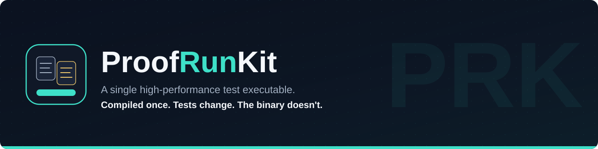
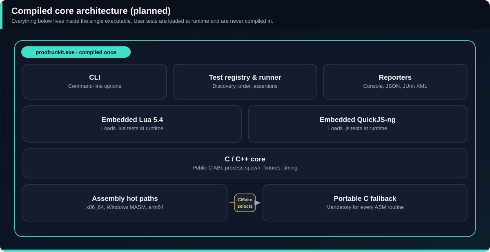

  

  
  
  

# ProofRunKit

A single high-performance test executable, compiled once. Tests change; the binary does not.

**Status: planning / pre-alpha.** The executable, interpreters, drivers, and installers described here are planned work, not shipped features. See the [open issues](https://github.com/Patrick-W-McMahon/ProofRunKit/issues).

## Why ProofRunKit

Rebuilding a custom C or C++ test executable whenever tests change produces a new file on disk. Antivirus tools often treat that rebuild as an unknown binary and flag it again.

ProofRunKit is designed to be compiled once and then reused. Tests live outside the executable — as Lua or JavaScript scripts, or as inputs to real compilers and runtimes — and are never compiled into the kit. When the tests change, only the tests change.

## Features (planned)

- One stable `proofrunkit` executable, with Assembly hot paths and a portable C fallback
- Kit-authored tests in **Lua 5.4** and **JavaScript (QuickJS-ng)**, loaded at runtime
- Compiler shell-out for C, C++, C#, and Assembly, then a run of the produced binary
- Runtime wrappers for Node.js (`node:test`, Vitest) and Python (pytest)
- HTML and CSS validation, with browser-driven checks later
- Reporters for the console, JSON, and JUnit XML
- Per-machine Windows installers for x64 and x86

## How it works

Kit-authored tests are ordinary Lua or JavaScript files on disk. The compiled `proofrunkit` executable loads them through embedded Lua 5.4 and QuickJS-ng interpreters and reports the results. The executable does not need to be rebuilt when those tests change.

  

The planned binary contains a C/C++ core (CLI, test registry and runner, process spawn, fixtures, timing), the two embedded interpreters, Assembly hot paths with a mandatory portable C fallback selected by CMake, and reporters. User tests are not compiled into that binary.

  

ProofRunKit is not an in-process compiler. For compiled languages it shells out to a real toolchain, captures diagnostics, exit codes, and output files, then launches the produced binary to check behavior. Script suites that already use Node.js or Python are invoked the same way.

  

## Supported languages

| Language | Planned approach |
| --- | --- |
| C and C++ | Shell out to gcc, clang, or MSVC `cl`; capture diagnostics and artifacts; run the produced binary |
| C# | Shell out to `dotnet`; capture diagnostics; run the produced program |
| Assembly | Assemble with `ml64` on Windows, or GAS / NASM elsewhere; link and run where applicable |
| JavaScript and TypeScript | QuickJS-ng for kit-authored tests; Node.js, `node:test`, and Vitest for existing suites |
| Lua | Lua 5.4, embedded in the kit, for kit-authored tests |
| Python | System Python and pytest |
| HTML and CSS | Validation and structure checks; Chrome-driven checks in a later issue |

None of these drivers are implemented yet.

## Platform support

| Platform | Status |
| --- | --- |
| Windows | First tested host |
| Linux | Planned |
| macOS | Planned |

CMake presets for Linux and macOS may appear before those hosts are formally tested. A preset is not the same as a supported, tested platform. x64 and x86 Windows installers are also planned ([issue #36](https://github.com/Patrick-W-McMahon/ProofRunKit/issues/36)).

## Getting started

ProofRunKit is pre-alpha. There is no supported build or install yet.

Configure and build instructions will land with the core executable and CMake presets ([issue #7](https://github.com/Patrick-W-McMahon/ProofRunKit/issues/7)). Windows will be the first platform with a documented build and self-test ([issue #23](https://github.com/Patrick-W-McMahon/ProofRunKit/issues/23)).

## Roadmap

The project is not complete until ProofRunKit has replaced at least one real existing test suite end to end ([issue #26](https://github.com/Patrick-W-McMahon/ProofRunKit/issues/26)). Suites will be migrated one project at a time. Existing test tools remain in place as a fallback until the maintainer approves removal ([issue #27](https://github.com/Patrick-W-McMahon/ProofRunKit/issues/27)).

Highlights:

- [Core executable and CMake presets](https://github.com/Patrick-W-McMahon/ProofRunKit/issues/7)
- [Embed Lua 5.4](https://github.com/Patrick-W-McMahon/ProofRunKit/issues/9) and [QuickJS-ng](https://github.com/Patrick-W-McMahon/ProofRunKit/issues/11)
- [Windows build and self-test](https://github.com/Patrick-W-McMahon/ProofRunKit/issues/23)
- [First suite migration (Trading Agent, doctest)](https://github.com/Patrick-W-McMahon/ProofRunKit/issues/28)
- [Windows installers](https://github.com/Patrick-W-McMahon/ProofRunKit/issues/36)

The full list is in the [issue tracker](https://github.com/Patrick-W-McMahon/ProofRunKit/issues).

## Contributing

Contribution guidelines will live in [`CONTRIBUTING.md`](CONTRIBUTING.md). That file is not in the tree yet; it is tracked as [issue #5](https://github.com/Patrick-W-McMahon/ProofRunKit/issues/5).

Until then, please open an issue before starting work and reference it from each commit (`Refs #N` or `Closes #N`). There is currently no GitHub Actions CI; build and test locally. Windows is the first test host.

## License

ProofRunKit will be licensed under the **Apache License 2.0**. The `LICENSE` file (verbatim Apache-2.0 text, so GitHub can detect it) and a `NOTICE` file will land with [issue #3](https://github.com/Patrick-W-McMahon/ProofRunKit/issues/3). They are not in the repository yet.

## Disclaimer

A separate liability notice will live in [`DISCLAIMER.md`](DISCLAIMER.md) and will be linked here when it lands. That file is tracked as [issue #4](https://github.com/Patrick-W-McMahon/ProofRunKit/issues/4). It will not modify the Apache License 2.0 terms.

## Attribution

If you use ProofRunKit, please credit the project and link to this repository: [https://github.com/Patrick-W-McMahon/ProofRunKit](https://github.com/Patrick-W-McMahon/ProofRunKit).

Downstream redistributions should retain attribution notices. See `NOTICE` (to be added in [issue #3](https://github.com/Patrick-W-McMahon/ProofRunKit/issues/3)) per Apache License 2.0, section 4(d).
